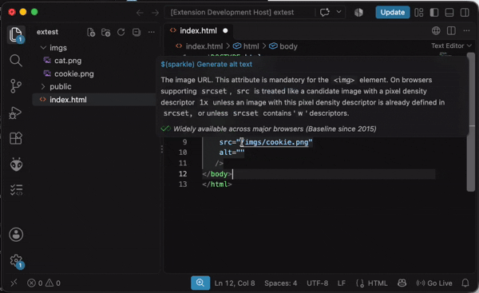

# AI Image Alt Text

Generate accessible image alt text in HTML, JSX, and TSX files using a locally running Ollama vision model. Image contents are sent only to the Ollama server you configure.



## Features

- Hover over an `` element with an empty or missing `alt` attribute and select **Generate alt text**.
- Press **Cmd+Shift+A** (or **Ctrl+Shift+A** on Windows/Linux) to fill empty or missing alt attributes in the current file.
- Supports multiline tags, other attributes, workspace-relative image files, and HTTP(S) image URLs.
- Existing non-empty alt text is never overwritten. Bulk generation reports individual image failures and applies successful results together.

## Requirements

- [Ollama](https://ollama.com/) running locally or at a server you can access.
- A vision-capable model installed in Ollama, for example:

  ```sh
  ollama pull gemma3:latest
  ```

The first generation prompts for the Ollama server URL (for example `http://localhost:11434`) and model name. These values are saved in the VS Code user settings. To change them, run **AI Image Alt Text: Configure Ollama** from the Command Palette, or edit `ai-img-alt-text.ollamaUrl` and `ai-img-alt-text.model` in Settings.

## Image paths

- A leading-slash path such as `/imgs/cookie.png` first resolves from the workspace root. If it is missing, the extension also checks `public/imgs/cookie.png`, a common static-asset convention.
- A relative path such as `../imgs/cookie.png` resolves from the current document's folder and must remain inside the workspace.
- Absolute `http://`, `https://`, and protocol-relative URLs are downloaded directly. Remote images must return an `image/*` content type.
- Images larger than 10 MB are rejected. Dynamic JSX values such as `src={image}` are not supported.

The extension does not overwrite existing descriptive alt text. In bulk mode it processes only tags with missing or empty alt attributes. A generated result is inserted as an escaped HTML attribute value.

## Troubleshooting

- Confirm the Ollama server URL is reachable and the model name matches an installed model (`ollama list`).
- Vision support is required; a text-only model may return an Ollama error.
- For missing local images, confirm the file exists inside the workspace and that the `src` path is relative to the document or workspace root as described above.

## Extension Development

- `npm install` installs development dependencies.
- `npm run compile` type-checks and compiles the extension.
- `npm test` compiles, lints, and runs the VS Code extension tests.
